# Nordvik steering hub (MCP app)

A role-based marketing dashboard that opens inside Claude as an MCP app. It helps answer one question, "where
should the next euro go?", on simulated data for a fictional outdoor-furniture brand, Nordvik Outdoor.

<!-- DEMO LINK: added later -->

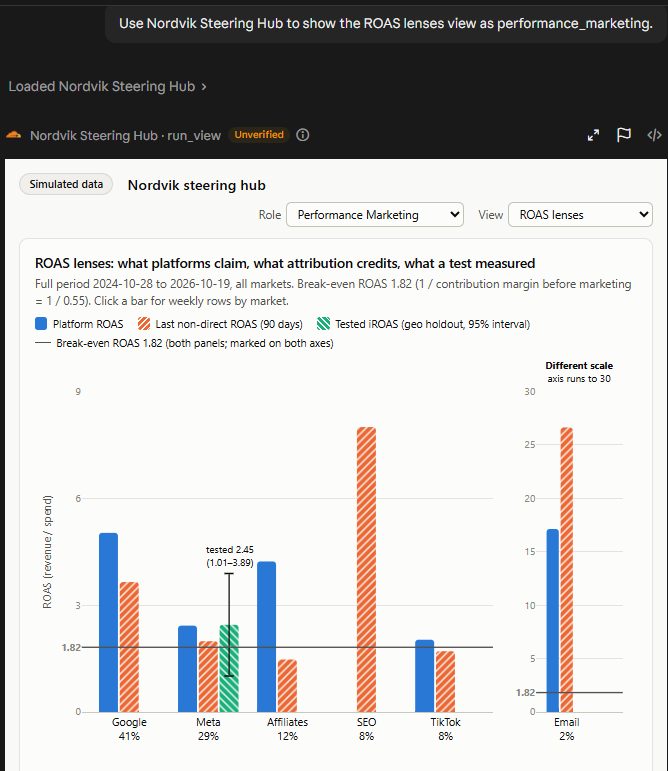

**All data is simulated.** No numbers here are real company results.

## What it shows

There are five views. Each view has a chart (or tiles) and a table, and you can click a chart element to drill down.
Every view reply also lists the definitions, sources and caveats behind its numbers.

| View | Options | Drilldown (segment) |
|---|---|---|
| `roas_lenses` | `overlay` (leadership only) | `{"channel": "Meta"}`: weekly rows by market, observable columns only |
| `business_health` | `metric` (`mer`, `cac`, `cm_after_marketing`), `group_by` (`market`, `week`), `market` | `{"market": "DE"}` or `{"week": "2026-03-02"}`: spend, orders, net revenue, MER |
| `attribution_sensitivity` | `channel` (Google, Meta, Affiliates, TikTok, SEO, Email) | `{"model": "last_click"}`: that model at 7, 30, 90 and 365 days |
| `conversion_lag` | none | `{"path": "all", "day": 30}`: blended CAC and payback ratio at 30, 90 and 365 days |
| `data_quality` | `overlay` (leadership only) | `{"check": "01"}`: the check's rule, action and flagged rows |

### ROAS lenses

Three ways to read return on ad spend (ROAS) per channel, side by side: what the ad platform claims, what
last non-direct attribution credits (90 days), and what a geo holdout test measured. A line marks break-even
ROAS, 1.82 (1 / contribution margin before marketing of 0.55).


*Meta: the platform claims 2.43, last non-direct credits 1.99, and the holdout test measured 2.45 (95% interval 1.01 to 3.89).*

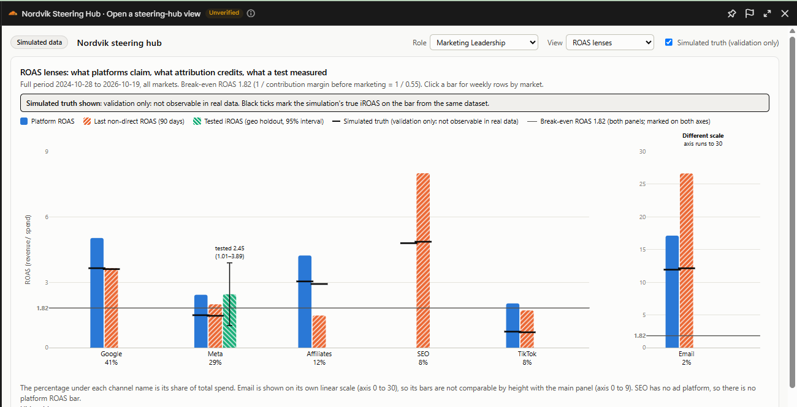

*With the leadership overlay, TikTok's platform ROAS of 2.03 meets a true return of 0.73, well below break-even (validation only).*

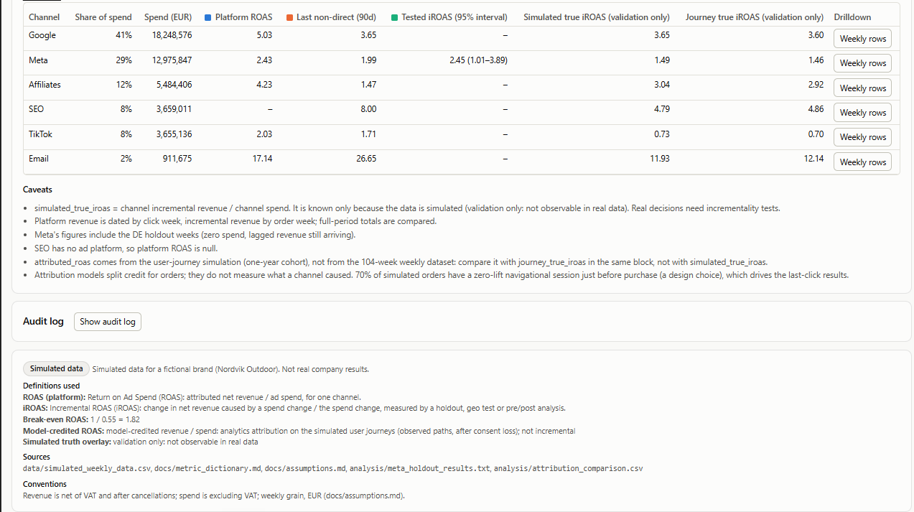

*The table under the chart repeats every number, with the caveats, definitions and source files.*

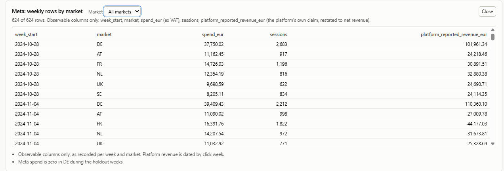

*Clicking a bar shows that channel's weekly rows by market: 624 rows for Meta, observable columns only.*

### Business health

MER (total net revenue / total marketing spend), blended CAC, or contribution margin after marketing, by market
or by week.

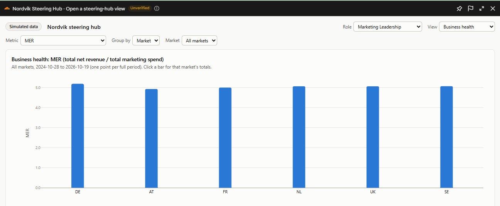

*MER is close across markets, from 4.93 in AT to 5.19 in DE, over 2024-10-28 to 2026-10-19.*

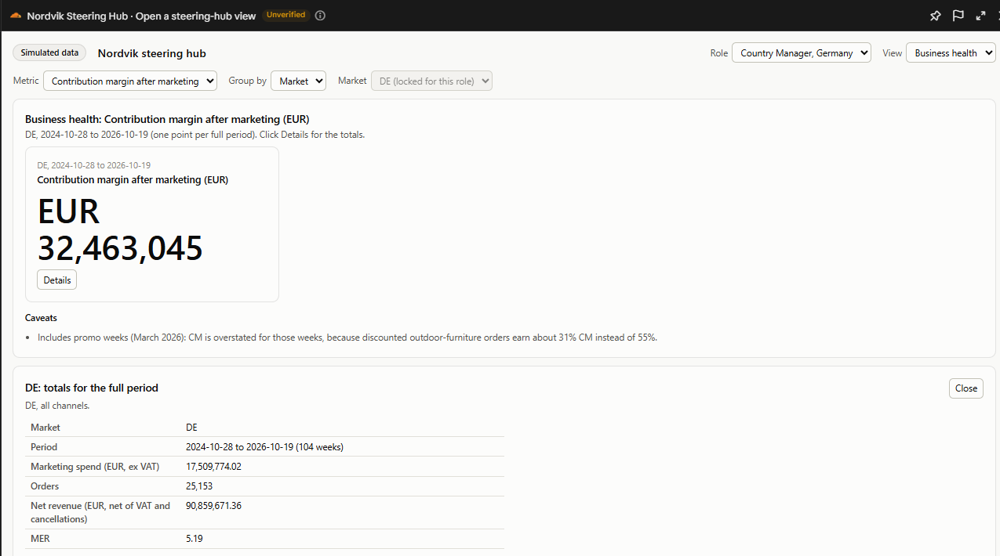

*The country manager sees DE only: contribution margin after marketing EUR 32,463,045, MER 5.19.*

### Attribution sensitivity

Model-credited ROAS for one channel under 8 attribution models (90-day lookback), against break-even. These numbers
come from the simulated user journeys (observed paths). Attribution splits credit; it does not measure what a
channel caused.

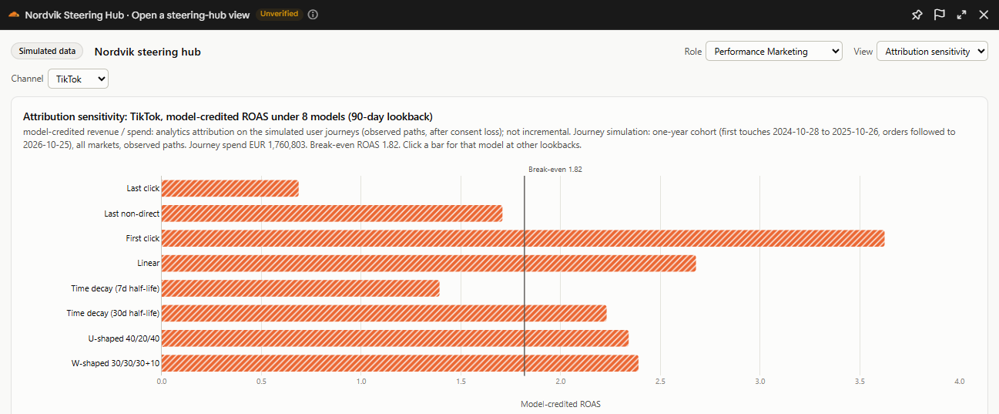

*TikTok's credited ROAS ranges from 0.69 to 3.62 across the 8 models, and 5 of 8 are above break-even 1.82. Its true return is 0.70 (validation only).*

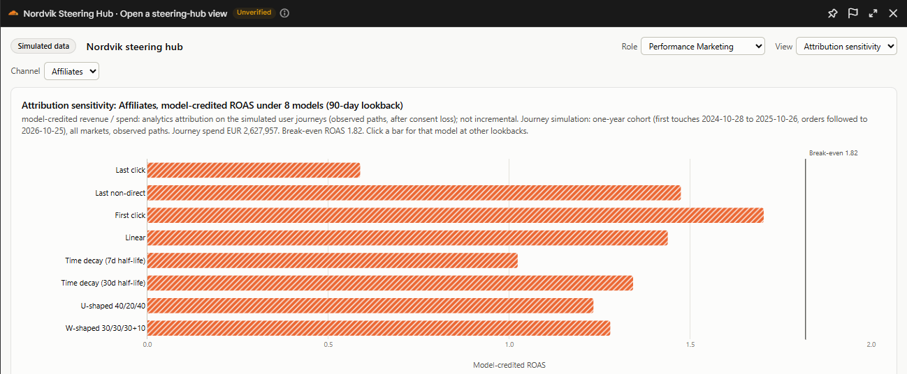

*Affiliates: all 8 models are below break-even, yet the true return is 2.92 (validation only).*

### Conversion lag

How much of a cohort's 365-day orders is visible after 7, 30, 90, 180 and 365 days, counted from the first click.
All markets are pooled.

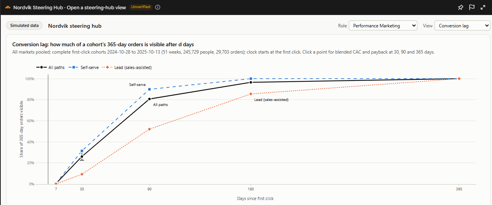

*At 90 days, 80.7% of orders are visible on all paths, but only 52.1% on the sales-assisted lead path. The payback ratio is 0.62 at 30 days and 2.05 at 90 days.*

### Data quality

Four SQL checks on the simulated data. Each tile shows a status (OK, WARN, FLAG or FAIL). Clicking a tile shows the
rule, the action and the flagged rows.

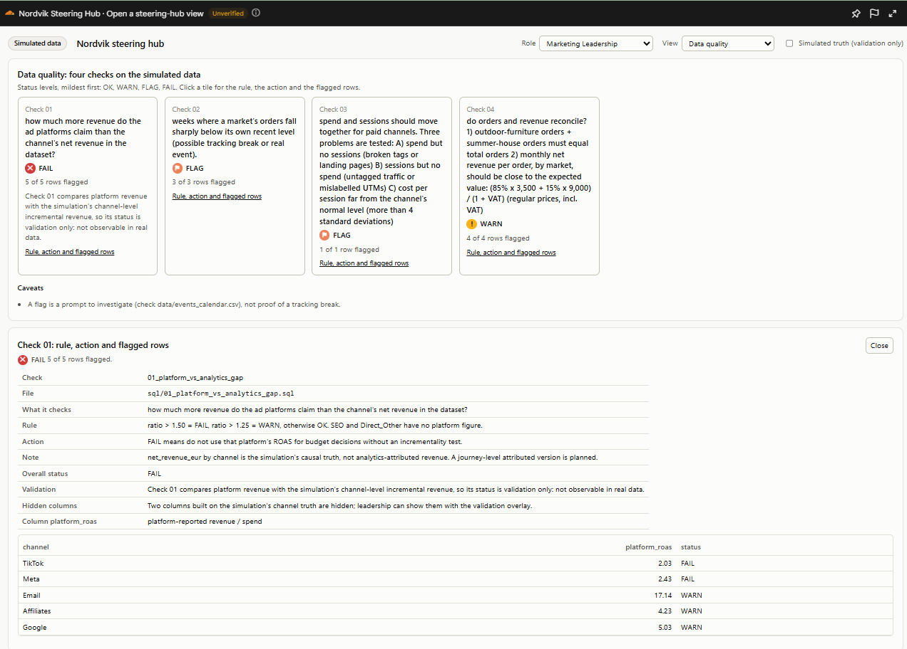

*Check 01 fails: platform claims for TikTok and Meta are far above their revenue in the dataset, and the other 3 paid channels warn (validation only). Checks 02 and 03 flag 3 and 1 rows, and check 04 warns on 4.*

## Roles and access

| Role | Label | Views | Rule |
|---|---|---|---|
| `country_manager_de` | Country Manager, Germany | business_health, conversion_lag | Market locked to DE |
| `performance_marketing` | Performance Marketing | roas_lenses, attribution_sensitivity, conversion_lag, data_quality | All markets |
| `leadership` | Marketing Leadership | All five | All markets, and may switch on the overlay |

- **DE lock.** For the country manager, no market means DE. Any other market, including `all`, is refused. Conversion
  lag is pooled over all markets in the results file, so the country manager sees the all-market figures, labelled as such.
- **Leadership-only overlay.** The overlay shows the simulation's true return, labelled "validation only: not
  observable in real data". It works on roas_lenses and on the check 01 drilldown in data_quality. Other roles get a
  refusal if they try to switch it on. Without the overlay, these fields are removed from every reply.
- **Refusals** return HTTP 403 with `{"error": "...", "access_denied": true}`. Bad input returns HTTP 400 with
  `"access_denied": false`.

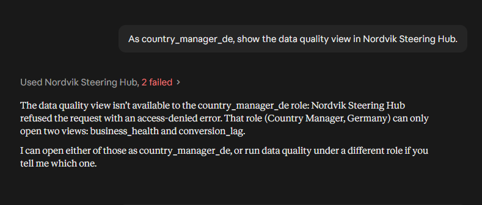

*Asking for data quality as the country manager is refused, and Claude explains which views the role can open.*

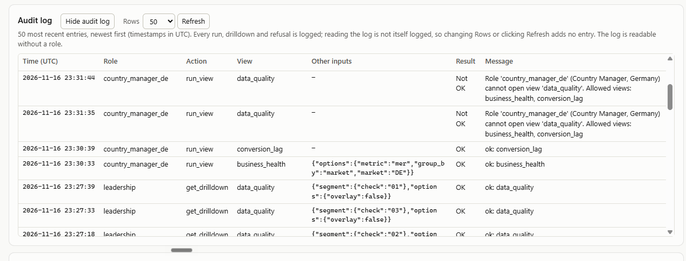

*Every run, drilldown and refusal adds one line to the audit log, including the two refusals above.*

The audit log is `mcp_app/logs/audit.jsonl`. Each line has `timestamp` (UTC), `role`, `action`, `inputs`, `success`
and `message`. Reading the log does not add a line. It is the only file the app writes.

## How it works

| Layer | Files | Job |
|---|---|---|
| Dashboard | `mcp-server/mcp-app.html`, `mcp-server/src/mcp-app.js` | Role, view and option menus, a Plotly chart or tiles per view, table, drilldowns, audit log panel |
| MCP server (TypeScript, port 3001) | `mcp-server/server.ts` | Four tools; serves the dashboard as `ui://nordvik/steering-hub` |
| Python API (Flask, port 5001) | `api.py`, `app/views.py`, `app/access.py`, `app/audit.py` | Access checks, calls the existing metric code, writes the audit log |

**The MCP server computes nothing.** Each tool forwards to the Python API (`NORDVIK_API_URL`, default
`http://127.0.0.1:5001`). The server is stateless and builds a fresh MCP server per request.

| MCP tool | API route | Returns |
|---|---|---|
| `list_views(role)` | `GET /api/views?role=` | The views a role can open, with their options |
| `run_view(role, view, options)` | `POST /api/run` | The view result; opens the dashboard |
| `get_drilldown(role, view, segment, options)` | `POST /api/drilldown` | The drilldown result |
| `get_audit_log(limit)` | `GET /api/audit?limit=` | Audit entries, newest first (limit 1 to 1000, default 50) |
| | `GET /api/roles` | The three roles, their views, market lock and overlay right |

Every successful reply has the same envelope: `data_origin: "simulated"`, `notice`, `definitions_used`,
`conventions`, `sources`, `caveats`, then `role`, `view`, `options`, `segment` (drilldowns only) and `result`.

**Every number comes from existing code or published files.** The Python API calls the tools in
`mcp_server/server.py` (`get_kpis`, `compare_roas`, `run_quality_check` and the metric-dictionary helpers). It does
not re-implement any formula. Where no tool exists, it reads the published files as they are:
`data/simulated_weekly_data.csv` (observable columns only), `analysis/attribution_comparison.csv` and
`analysis/conversion_lag_results.txt`. Parity tests check every view and drilldown against the tool output or the
file, and a further test checks that `app/views.py` holds no formula constants.

## How to run it

You need Python 3 and Node 20.11 or later (tested with Node 26.13). Run the Python steps from the repository root.
Use two terminals: one for the API, one for the MCP server.

**1. Set up Python (once)**

Windows, PowerShell:

```powershell
python -m venv .venv
.venv\Scripts\python.exe -m pip install -r requirements.txt -r mcp_app/requirements.txt
```

Windows, Git Bash (same folders, forward slashes):

```bash
python -m venv .venv
.venv/Scripts/python.exe -m pip install -r requirements.txt -r mcp_app/requirements.txt
```

macOS or Linux:

```bash
python3 -m venv .venv
.venv/bin/python -m pip install -r requirements.txt -r mcp_app/requirements.txt
```

**2. Start the API (terminal 1)**

| Shell | Command |
|---|---|
| PowerShell | `.venv\Scripts\python.exe mcp_app/api.py` |
| Git Bash | `.venv/Scripts/python.exe mcp_app/api.py` |
| macOS or Linux | `.venv/bin/python mcp_app/api.py` |

The API listens on `http://127.0.0.1:5001`.

**Startup warm-up.** At startup, a background thread pre-computes the weekly business-health series: 104 `get_kpis`
calls for each of seven market options (all markets and DE first, then AT, FR, NL, UK, SE). On the development
laptop this took about 5.5 minutes, or 45 to 50 seconds per market. The API answers other requests meanwhile. A
weekly request for a market that is not warm yet is computed on demand, so it is slow the first time. Only
`mcp_app/api.py` starts the warm-up; the tests never run it.

**3. Build and start the MCP server (terminal 2)**

The same commands work in all three shells:

```bash
cd mcp_app/mcp-server
npm ci            # exact versions from package-lock.json
npm run build     # builds dist/mcp-app.html (one file; Plotly 4.3.0 loads from cdn.plot.ly)
npm start         # http://127.0.0.1:3001/mcp
```

Stop both servers with Ctrl+C. To check the ports are free afterwards:

- PowerShell: `Get-NetTCPConnection -LocalPort 3001,5001 -State Listen` should return nothing.
- macOS or Linux: `lsof -iTCP:3001 -iTCP:5001 -sTCP:LISTEN` should return nothing.

## Testing in basic-host

basic-host is the test host from the MCP Apps repository. With the API and the MCP server running, set it up in a
folder outside this repository:

```bash
git clone https://github.com/modelcontextprotocol/ext-apps.git
cd ext-apps
npm install
cd examples/basic-host
```

Then start it, pointing it at this server:

- PowerShell: `$env:SERVERS='["http://127.0.0.1:3001/mcp"]'; npm run start`
- Git Bash, macOS or Linux: `SERVERS='["http://127.0.0.1:3001/mcp"]' npm run start`

Open `http://localhost:8080`. Start it from `examples/basic-host`: `npm start` in the ext-apps root also starts all
their example servers.

**The arguments box resets.** Pick the Nordvik server and the `run_view` tool first. Then replace `{}` in the
arguments box, for example with `{"role": "performance_marketing", "view": "roas_lenses"}`. The box resets to `{}`
whenever a server or tool is selected. A call without `role` and `view` is refused with "MCP error -32602: Input
validation error".

## Connecting it to Claude

Claude needs a public HTTPS address, but the MCP server only listens on `127.0.0.1`. A cloudflared quick tunnel
bridges the two. With the API and the MCP server running, open a third terminal:

```bash
npx cloudflared tunnel --url http://127.0.0.1:3001 --http-host-header 127.0.0.1:3001
```

`npx` downloads cloudflared on first use, so nothing needs installing. If cloudflared is already installed, plain
`cloudflared tunnel ...` with the same arguments works too.

The tunnel prints a random public address. In Claude, add a custom connector with that address plus `/mcp`
(`https://<your-tunnel-address>/mcp`). Then ask, for example: "Use Nordvik Steering Hub to show the ROAS lenses view
as performance_marketing."

**Why `--http-host-header 127.0.0.1:3001` is needed.** The MCP server binds to `127.0.0.1`, so the MCP SDK turns on
DNS rebinding protection: it accepts only requests whose `Host` header is a localhost name. Requests through the
tunnel arrive with the tunnel's hostname, so they would be refused. The flag rewrites the `Host` header to
`127.0.0.1:3001` before the request reaches the server.

**Claude can keep showing an older copy of the dashboard.** After a rebuild (`npm run build`), Claude may still show
the previous dashboard. What fixed it: stop the tunnel, start a new one (which
gives a new address), and remove and re-add the connector with the new address.

A quick tunnel's address changes every time it starts, and anyone with the address can reach the app while the
tunnel runs. Stop it when you are done.

## Tests

Run from the repository root (use the Python path for your shell, as in "How to run it"):

```bash
.venv/bin/python -m pytest tests            # the mcp_server tools
.venv/bin/python -m pytest mcp_app/tests    # the steering hub API, about 2 minutes
```

**`tests/`** checks the existing `mcp_server` tools that this app builds on. Tool results match independent pandas
and DuckDB calculations, the published result files and the budget memo. It also checks the tools are read-only and
that the MCP protocol works. Add `-m "not slow"` to skip the slow tests.

**`mcp_app/tests`** checks the steering hub API:

| File | What it checks |
|---|---|
| `test_access.py` | Each role sees only its views; the country manager is locked to DE; refusals are 403 and bad input is 400 |
| `test_overlay.py` | Simulated-truth fields are absent from every reply unless the role is leadership and the overlay is on |
| `test_parity.py` | Every view and drilldown equals the `mcp_server` tool output or the published file value |
| `test_audit.py` | Every run, drilldown and refusal adds exactly one audit line with the six keys; reads add none |
| `test_read_only.py` | A before-and-after file hash shows nothing in the repository changes; `views.py` holds no formula constants |
| `test_warm_up.py` | The warm-up covers every market, never starts in the tests, and the API answers while it runs |

**TypeScript type check** for the MCP server and dashboard:

```bash
cd mcp_app/mcp-server
npm run typecheck   # tsc --noEmit
```

## Limits

- **Simulated data.** The brand, markets and numbers are invented. The "true return" exists only because the data
  is simulated; real decisions need incrementality tests.
- **No real login.** The caller chooses the role. This shows role-based views, not access control.
- **The audit log is readable without a role.** `GET /api/audit` and `get_audit_log` take no role, so anyone who can
  reach the API can read every entry.
- **Restart after regenerating data.** Results are cached in memory for the life of the API process. After running
  `generate_data.py`, `generate_journeys.py` or the analysis scripts, restart the API; otherwise it keeps serving the
  old numbers.
- **Conversion lag is pooled over all markets.** It cannot be limited to one market without recomputing the analysis.
