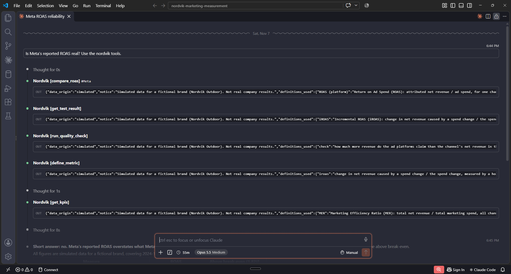
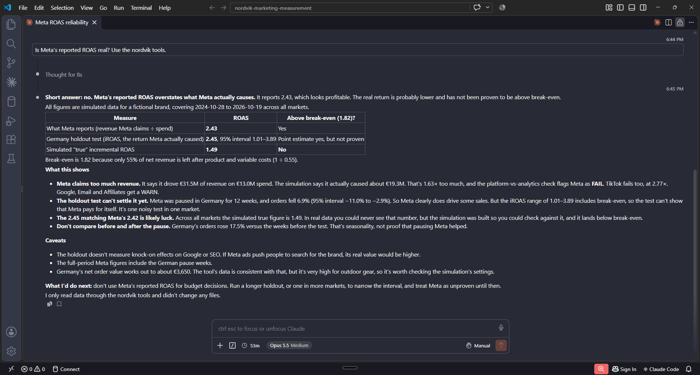

# Nordvik MCP server

A small, **read-only** MCP server for Claude Desktop and Claude Code. Claude answers questions about Nordvik with the repo's **agreed metric definitions** (`docs/metric_dictionary.md`) and data, and doesn't calculate its own versions.

> **All data is simulated.** The brand, markets and results are fictional. Every tool response says so, and also states the definitions it used and the source files it read.

Stack: Python, the official MCP Python SDK (`FastMCP`, `mcp>=1.10,<2`), DuckDB on the existing CSVs, stdio transport only. Spec: [`docs/mcp_server_spec.md`](../docs/mcp_server_spec.md).

## Install

From the repository root:

```
pip install -r mcp_server/requirements.txt
python -m pytest tests -v        # 59 tests, up to about 3 minutes, including the slow test that re-runs the analyses (add -m "not slow" to skip it)
```

The server works from any working directory, because it resolves all paths from its own location.

## Connect

**Claude Desktop:** add this to `claude_desktop_config.json` (Settings → Developer → Edit config), use your own absolute paths, then restart Claude Desktop:

```json
{
  "mcpServers": {
    "nordvik": {
      "command": "python",
      "args": ["C:\\path\\to\\nordvik-marketing-measurement\\mcp_server\\server.py"]
    }
  }
}
```

If you installed the requirements in a virtual environment, use that environment's Python as `command`, as a full absolute path: `...\.venv\Scripts\python.exe` on Windows or `.../.venv/bin/python` on macOS/Linux. Plain `python` may start a different Python that doesn't have the `mcp` package. The same applies to the Claude Code command below.

**Claude Code:** run this from the repository root:

```
claude mcp add nordvik -- python mcp_server/server.py
```

## Tools

All tools are read-only (`readOnlyHint`). They return JSON with the same envelope: `data_origin: "simulated"`, `notice`, `definitions_used`, `conventions`, `sources`, `result` and `caveats`. Invalid inputs return an error that lists the valid values.

| Tool | Returns |
|---|---|
| `list_metrics()` | The 6 metrics (CAC, ROAS, MER, contribution margin, payback, iROAS) with one-line definitions, parsed from `docs/metric_dictionary.md` |
| `define_metric(name)` | Full definition: formula, includes/excludes, example, notes and the raw section. Accepts the key, the abbreviation or the full name, in any case |
| `get_kpis(market="all", channel="all", start=None, end=None)` | Spend, orders, net revenue, MER, CAC, and contribution margin before and after marketing. Dates are ISO and inclusive on `week_start`. With a channel filter, `mer` is null and `simulated_incremental_roas` is returned instead, and CAC becomes *simulated incremental CAC* |
| `compare_roas(channel="all")` | Platform ROAS vs simulated true iROAS (*validation only: not observable in real data*), break-even 1.82, and the Meta holdout result. `attributed_roas` holds model-credited ROAS from the journey simulation (`analysis/attribution_comparison.csv`, observed paths): all 8 attribution model variants at a 90-day lookback, last non-direct click at 7 / 30 / 90 / 365 days, and the journey's true iROAS (*validation only*) |
| `run_quality_check(name)` | Runs one SQL check (`01`–`04` or its name, e.g. `platform_vs_analytics_gap`) and returns its rule, its rows and an overall status |
| `get_test_result(test)` | `meta_holdout` or `discount`, parsed from `analysis/*_results.txt`, with the 95% intervals and a verdict |

Conventions and caveats:
- Revenue is net of VAT and cancellations, and spend is ex VAT.
- Channel-level revenue is described as *incremental* (the revenue each channel caused in the simulation), never as attributed revenue.
- Contribution margin is a flat 55% of net revenue. A caveat is added whenever the window overlaps the promo, because that overstates margin in discounted weeks.
- Windows shorter than 13 weeks get a buying-window caveat.

## How the tests check the numbers

`tests/test_mcp_tools.py` compares the tools against:
- an independent pandas recalculation of the CSV;
- the published outputs: `analysis/*_results.txt` (e.g. Meta holdout iROAS **2.45**, 1.01 to 3.89), the SQL check rows (run directly through DuckDB), the findings in `sql/README.md`, the `docs/budget_memo.md` table, the README headlines, and `analysis/attribution_comparison.csv` (for `attributed_roas`);
- contract rules: the envelope, validation errors, "incremental not attributed" wording, a before/after file hash showing nothing is written, and an in-memory MCP client session.

A `slow` test re-runs both analysis scripts in a temp folder and checks that the committed results files still reproduce from the current data.

## Demo

Three questions asked in Claude Code (VS Code) with the `nordvik` server connected. All figures are simulated data for a fictional brand. The answers are lightly edited for length; corrections are marked.




### Q1. "Is Meta's reported ROAS real?"

Tools called: `compare_roas`, `get_test_result`, `run_quality_check`, `define_metric`, `get_kpis`.

**Short answer: no.** Meta's reported ROAS overstates what Meta actually causes.

| Measure | ROAS | Above break-even (1.82)? |
|---|---|---|
| What Meta reports (revenue Meta claims ÷ spend) | **2.43** | Yes |
| Germany holdout test (iROAS) | **2.45**, 95% interval 1.01–3.89 | Point estimate yes, but not proven |
| Simulated "true" incremental ROAS | **1.49** | **No** |

- **Meta claims too much revenue:** €31.5M claimed on €13.0M spend, against about €19.3M actually caused (1.63×). The platform vs channel revenue check (01) flags Meta as FAIL; TikTok fails too (2.77×).
- **The holdout can't settle it yet:** orders fell 6.9% (95% interval −11.0% to −2.9%) during the 12-week pause in Germany, so Meta drives some sales, but the iROAS interval includes break-even.
- **The 2.45 matching Meta's 2.42 is likely luck:** the simulated true figure is 1.49. Real data would never show this number; the simulation exists so the methods can be checked against it.
- **Don't compare before and after the pause:** German orders rose 17.5% against the weeks before the test. That is seasonality.

**Next step:** don't use Meta's reported ROAS for budget decisions; run a longer holdout, or one in more markets.

### Q2. "What were MER, CAC and contribution margin in Germany from 2 March to 26 April 2026, and how is MER defined?"

Main tools: `get_kpis`, `define_metric`.

| Metric | Value |
|---|---|
| Marketing spend (excl. VAT) | €1,599,747 |
| Net revenue (net of VAT and cancellations) | €7,611,995 |
| Orders | 2,343 |
| **MER** | **4.76** |
| **CAC** | **€682.78** |
| Contribution margin after marketing | €2,586,850 (34.0% of net revenue) |

**MER** (from `docs/metric_dictionary.md`): total net revenue ÷ total marketing spend, across all channels, with no attribution. It can't be double-counted, but it is an average, not the return on the next euro.

**Caveats returned by the tool:** the window includes the March 2026 promo, so contribution margin is overstated for those weeks (discounted outdoor-furniture orders earn about 31% CM instead of 55%); and 8 weeks is short against a 30–90 day buying window.

> **What this question revealed, and the fix.** The first answer claimed CAC was understated because "orders include repeat buyers". That was wrong: `docs/assumptions.md` sets repeat purchases to 0%, so every order is a new customer. The model guessed because the tool response didn't state the assumption. `get_kpis` now adds it to the CAC definition ("Orders = new customers (assumption: no repeat purchases)"), and a test keeps it in place. This is the point of the server: if a definition isn't in the tool output, the AI fills the gap itself.

### Q3. "Run the data-quality checks. What is flagged, and what should we do about it?"

Main tool: `run_quality_check` (all four checks).

| Check | Status | What it flagged |
|---|---|---|
| 01 Platform vs channel revenue | **FAIL** | TikTok claims 2.77× the revenue it caused, Meta 1.63×. Email (1.44×), Affiliates (1.39×) and Google (1.38×): WARN |
| 02 Weekly order drops | **FLAG** | FR week of 2025-10-20 (−40%), UK week of 2025-10-20 (−41%), FR week of 2025-11-03 (−46%) |
| 03 Spend vs sessions | **FLAG** | AT Google, week of 2024-12-16: €19,719 spend for 803 sessions |
| 04 Revenue reconciliation | **WARN** | Revenue per order 17–19% below normal in AT, DE, FR and NL in March 2026 |

1. **Platform overclaiming (01) matters most:** don't set TikTok or Meta budgets on their own ROAS; geo-test TikTok before spending more.
2. **FR and UK drops (02):** single-week drops that match no event in the calendar. The check's action is to compare them with the release and outage log before calling them tracking errors. *(Corrected: the original answer called them "likely data breaks". No tracking errors are planted in this dataset, so they are random swings in small markets; in real data they would be investigated.)* Useful side note from the answer: FR and UK are in the control group of the Germany Meta holdout, so re-running the holdout without these weeks would show whether they affect its result.
3. **AT Google cost per session (03):** one week, more than 4 standard deviations from normal; check the invoice for a billing error or bot traffic.
4. **March 2026 revenue per order (04):** expected. It is the spring promo (headline 40% off selected lines) in exactly the four promo markets. Margin figures that include March should use the discount analysis, not the flat 55%.
